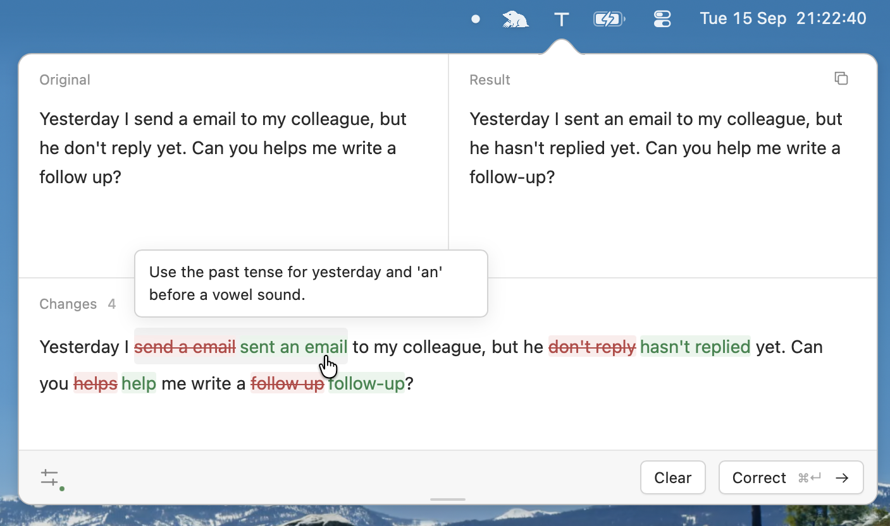

<h1 align="center">GrammarBar</h1>

<p align="center">Fix your English from the macOS menu bar.<br>Keep your voice, see every change, and learn why it was made.</p>

<p align="center">
  <a href="https://github.com/TABmk/GrammarBar/issues"></a>
  <a href="https://github.com/TABmk/GrammarBar/pulls"></a>
  <a href="#license"></a>
  <a href="https://github.com/TABmk/GrammarBar/stargazers"></a>
</p>

<p align="center">
  
</p>

## Quick Start

1. Open the **[latest release](https://github.com/TABmk/GrammarBar/releases/latest)** and download the ZIP under **Assets**:
   - **Apple Silicon (M-series):** `GrammarBar-macos-arm64.zip`
   - **Intel:** `GrammarBar-macos-x64.zip`
2. Unzip it, move **GrammarBar.app** to **Applications**, and open it.
3. Click the GrammarBar menu-bar icon, open **Settings → Connect**, and sign in with your ChatGPT account. Save your instructions and preferred model.
4. Paste your text and press **Correct** or **⌘↵**. Hover over a change to see its explanation.

## Features

- **One-click access** — opens below the menu-bar icon and hides when you click away.
- **Your writing rules** — save custom instructions and choose a model from your account.
- **Visible corrections** — removed text is red and struck through; additions are green.
- **Explanations on hover** — understand the reason behind each correction.
- **A compact workspace** — resize the window vertically; changes appear only when present.
- **Copy and clear** — copy the result or clear all text for your next message.

<details>
<summary><strong>ChatGPT and privacy</strong></summary>

GrammarBar uses the official Codex App Server over local stdio to sign in through your ChatGPT account and request corrections. It does not automate the ChatGPT website. The app bundles the official `@openai/codex` 0.154.0 runtime and its helpers; Node.js is not required to run a release build.

Text is submitted for correction only when you press **Correct**. Corrections use ephemeral sessions, and the editor does not save a text history. Filesystem, shell, and web tools are disabled; unexpected tool requests are refused.

Codex stores credentials in macOS Keychain using an app-specific home. Settings live in `~/Library/Application Support/com.tabmk.grammarbar/settings.json`. Existing installations keep the legacy `local.textfixer` directory to preserve sign-in and settings.

Rust validates that the returned correction segments reconstruct the original text before displaying them. The interface renders model output as plain text, never HTML.

</details>

<details>
<summary><strong>Development</strong></summary>

Built with Rust, Tauri 2, and plain HTML/CSS/JavaScript. Requires Rust, Node.js, and Apple Command Line Tools (`xcode-select --install`). CI uses Node.js 22 and stable Rust.

```sh
git clone https://github.com/TABmk/GrammarBar.git
cd GrammarBar
npm ci
npm run dev
```

Build and open a standalone app:

```sh
npm run build
open 'src-tauri/target/release/bundle/macos/GrammarBar.app'
```

Run checks from a fresh checkout:

```sh
node scripts/prepare.mjs
npm test
cargo clippy --manifest-path src-tauri/Cargo.toml -- -D warnings
```

The preparation script bundles the matching Codex runtime and verifies its signatures without executing it. Re-test authentication and corrections when updating Codex: its protocol is version-dependent.

The transparent popover uses Tauri's `macos-private-api` feature. An App Store release would need a different implementation.

</details>

<details>
<summary><strong>Release workflow</strong></summary>

[GitHub Actions](https://github.com/TABmk/GrammarBar/actions/workflows/release.yml) builds and tests Apple Silicon and Intel versions on every pushed tag. After both succeed, it publishes the ZIP archives to GitHub Releases. Each archive includes the matching Codex runtime.

Update the version in `package.json`, `package-lock.json`, `src-tauri/Cargo.toml`, `src-tauri/Cargo.lock`, and `src-tauri/tauri.conf.json`, then commit and push the changes before tagging. For example:

```sh
git tag v0.1.0
git push origin v0.1.0
```

The workflow uses the built-in `GITHUB_TOKEN`; no additional secrets are required. Re-running a tag workflow replaces its ZIP assets. Apple Developer signing and notarization are not configured. Never bypass a macOS malware warning; obtain a verified replacement from its official source.

</details>
